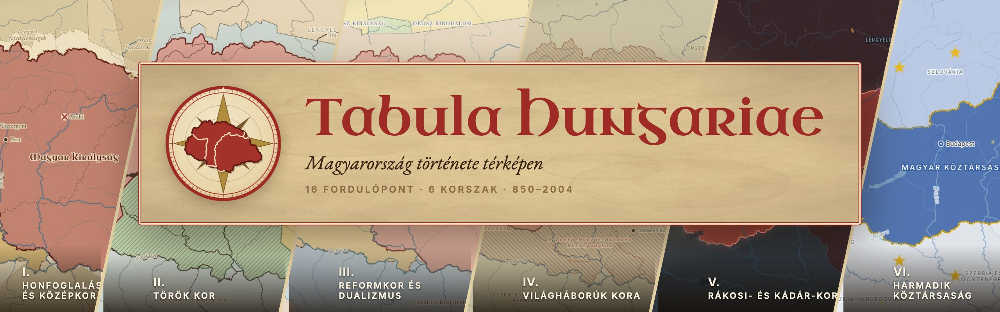
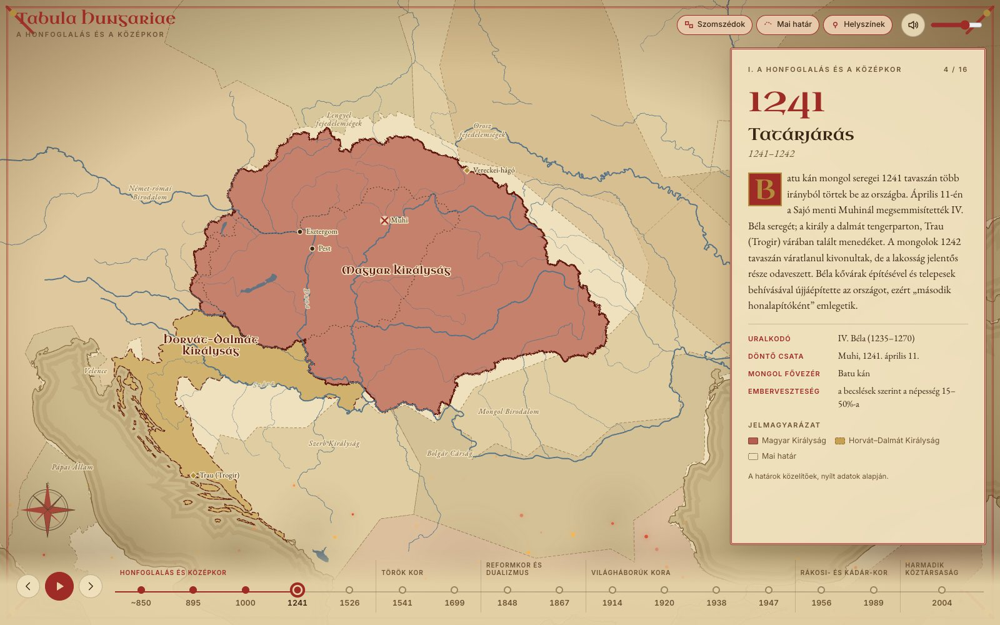
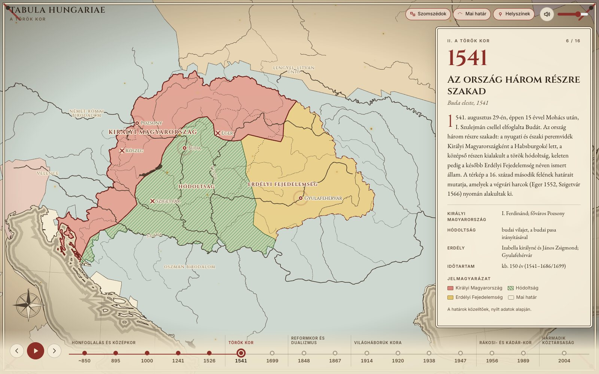
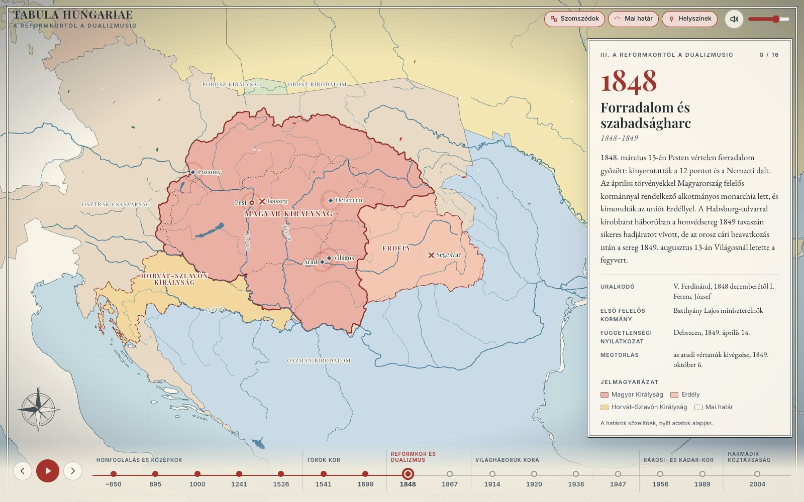
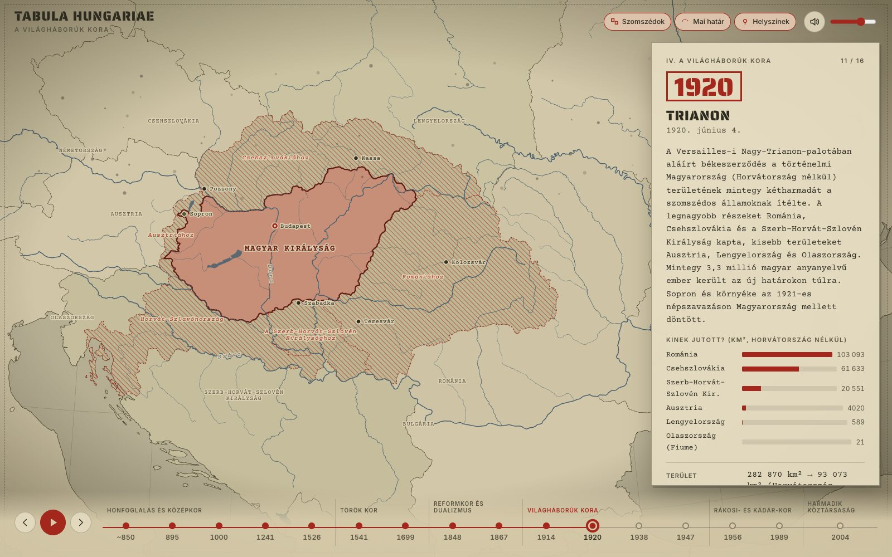
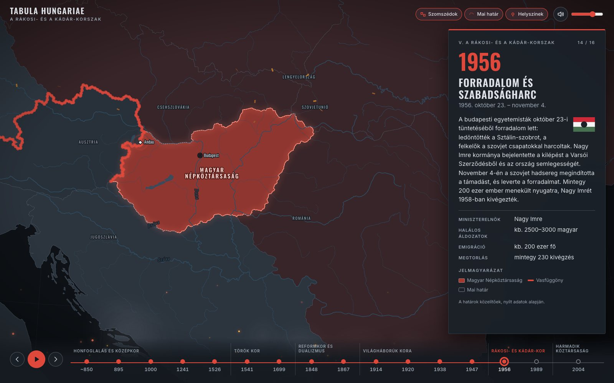
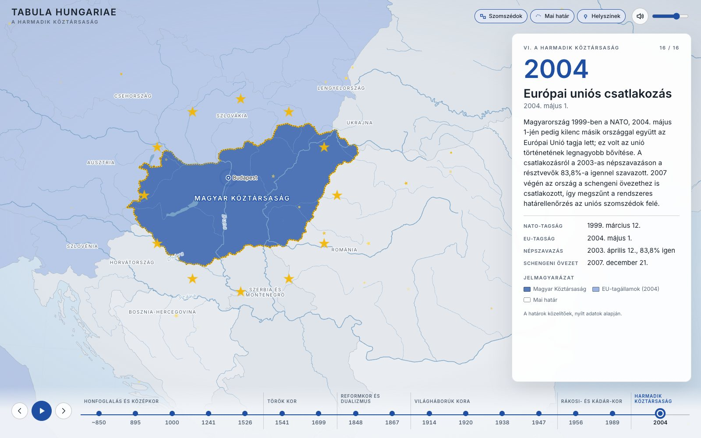
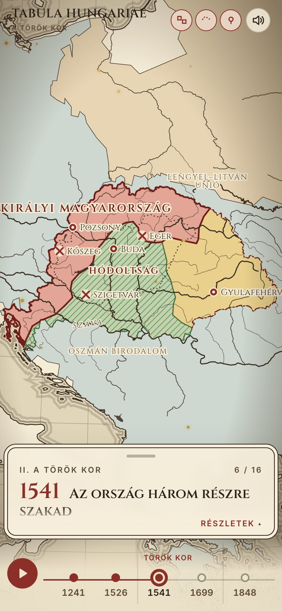

<p align="center">
  <a href="https://szemerics.github.io/tabula-hungariae/"></a>
</p>

<p align="center">
  <b>Interaktív történelmi atlasz: Magyarország határai 16 fordulóponton át,<br>a honfoglalás előtti Etelköztől a 2004-es uniós csatlakozásig.</b>
</p>

<p align="center">
  <a href="https://szemerics.github.io/tabula-hungariae/"></a>
</p>

<p align="center">
  
  
  
  
</p>

---

## Pergamentől pixelig

A térkép nemcsak a határokat mutatja, hanem a korszak saját térképészeti stílusában is jelenik meg: a középkori krónikák pergamenjétől a török kor rézmetszetein, a 19. századi kőnyomatos atlaszokon és a világháborús hadi térképeken át a hidegháború sötét képernyőjéig és a mai, letisztult atlaszig. Minden korszaknak saját betűtípusa, színvilága, papírtextúrája, hangulata és hangképe van.

| | Korszak | Fordulópontok | A térkép stílusa |
|:-:|---|---|---|
| I. | **A honfoglalás és a középkor** | ~850 Etelköz · 895 Honfoglalás · 1000 Államalapítás · 1241 Tatárjárás · 1526 Mohács | pergamen, rubrikált iniciálék, tollrajzos határok |
| II. | **A török kor** | 1541 Három részre szakadás · 1699 Karlócai béke | kézzel színezett rézmetszet, iránytűrózsa |
| III. | **A reformkortól a dualizmusig** | 1848 Forradalom és szabadságharc · 1867 Kiegyezés | 19. századi kőnyomatos atlasz |
| IV. | **A világháborúk kora** | 1914 Első világháború · 1920 Trianon · 1938–41 Bécsi döntések · 1947 Párizsi béke | szépia hadi térkép, hajtásnyomok, gépírás |
| V. | **A Rákosi- és a Kádár-korszak** | 1956 Forradalom · 1989 Rendszerváltás | sötét hidegháborús térkép, vasfüggöny |
| VI. | **A harmadik köztársaság** | 2004 EU-csatlakozás | modern atlasz, uniós csillagkör |

<table>
  <tr>
    <td width="33%"><br><sub><b>I.</b> 1241: Tatárjárás</sub></td>
    <td width="33%"><br><sub><b>II.</b> 1541: Három részre szakadás</sub></td>
    <td width="33%"><br><sub><b>III.</b> 1848: Forradalom és szabadságharc</sub></td>
  </tr>
  <tr>
    <td><br><sub><b>IV.</b> 1920: Trianon</sub></td>
    <td><br><sub><b>V.</b> 1956: Forradalom</sub></td>
    <td><br><sub><b>VI.</b> 2004: EU-csatlakozás</sub></td>
  </tr>
</table>

## Funkciók



- **Idővonal** korszakokra bontva, előre/hátra lapozással és automatikus **lejátszással**.
- **Animált határok:** a határok tintavonalként rajzolódnak ki, a kamera az események között repül.
  - **Trianon:** az 1914-es ország darabjai leszakadnak, egy grafikon mutatja, kinek mennyi jutott.
  - **1938–41:** a négy visszacsatolás lépésenként jelenik meg.
  - **1989:** megnyílik a vasfüggöny magyar–osztrák szakasza.
  - **2004:** kirajzolódik az uniós csillagkör.
- **Generált hangok** (Web Audio API, külső hangfájl nélkül): sztyeppei szél és pentaton furulya, koronázási harangok, mongol hadidobok, mehteri ritmus, barokk csembaló, kokárdás menetdob, keringőző zenélődoboz, tüzérség, légiriadó, rádiózaj és morze-SOS, végül az Örömóda.
- **Részecske-effektek:** por, parázs, füst, hamu, piros-fehér-zöld kokárdaszirmok, arany csillagok.
- **Ki- és bekapcsolható rétegek:** szomszédos hatalmak, a mai határ, városok és csatahelyek.
- **Kulcsadatok és jelmagyarázat** minden eseményhez, magyarul.
- **Telefonon is:** összecsukható kártya, húzással lapozás.
- **Billentyűk:** ← → lapozás, szóköz lejátszás, Home/End az elejére vagy a végére.
- **Mélylinkek:** minden eseménynek saját címe van, pl. [`#1920`](https://szemerics.github.io/tabula-hungariae/#1920).

<br clear="right">

## A név

A *Tabula Hungariae* Lázár deák 1528-ban kiadott térképének címe. Ez a legrégebbi fennmaradt, Magyarországot ábrázoló térkép.

## Futtatás helyben

Statikus oldal (HTML, CSS, ES modulok), build lépés nélkül. A böngésző `file://` címről nem tölt be modulokat, ezért egy helyi webszerver kell:

```bash
python3 -m http.server 8000
```

Ezután nyisd meg: <http://localhost:8000>. A `?intro=0` paraméter átugorja a nyitóképernyőt (pl. `http://localhost:8000/?intro=0#1541`).

## Felépítés

```
index.html             az oldal váza
assets/js/events.js    TARTALOM: korszakok, események, szövegek, kulcsadatok, helyszínek
assets/js/app.js       vezérlés: idővonal, kártya, lejátszás, rétegek
assets/js/map.js       térkép: rétegek, kamera, feliratok, animációk (d3)
assets/js/audio.js     generált hangok
assets/js/fx.js        papírtextúrák és részecskék
assets/css/main.css    a hat korszak stílusa
data/map.topo.json     előállított térképadat (TopoJSON)
tools/                 adat-, logó- és képgeneráló scriptek (Node)
docs/media/            képernyőképek, banner, közösségi előnézet
```

Szöveg javításához vagy új eseményhez elég az `assets/js/events.js`-t szerkeszteni. Új határokhoz a `tools/build-map.mjs`-ben kell felvenni az esemény területeit.

## A térképadat

A határok **közelítőek**. Forrásaik:

- **[Natural Earth](https://www.naturalearthdata.com/)** 1:10m (közkincs): közigazgatási egységek, folyók, tavak. A történelmi Magyar Királyság határait a mai megyékből és régiókból rakja össze a script (Partium és Erdély megyéi, Vajdaság, Kárpátalja, Burgenland, Muravidék stb.).
- **[aourednik/historical-basemaps](https://github.com/aourednik/historical-basemaps)** (GPL-3.0): a szomszédos hatalmak 1920 előtt.
- **Kézzel rajzolt választóvonalak** (`tools/build-map.mjs`): a hódoltság (16. század második fele), a Temesköz (1699), az első és a második bécsi döntés, Bácska és a Baranyai-háromszög (1941).

Az eszközök futtatása:

```bash
cd tools
npm install
npm run build          # data/map.topo.json (az első futás letölti a forrásokat)
node make-logo.mjs     # assets/img/logo.svg és favicon.svg
node make-media.mjs    # docs/media/*: futó helyi szerver és telepített Chrome kell hozzá
```

Az adat ellenőrzéséhez: `tools/preview.html` (pl. `http://localhost:8000/tools/preview.html?only=e1541`).

## Közzététel

Az oldalt a GitHub Pages szolgálja ki a `main` ág gyökeréből. Minden útvonal relatív, így alkönyvtárból és saját domainről is működik.

## Licenc

A `data/map.topo.json` részben a GPL-3.0 licencű historical-basemaps adatkészletből származik, ezért erre a fájlra a GPL-3.0 feltételei vonatkoznak.
